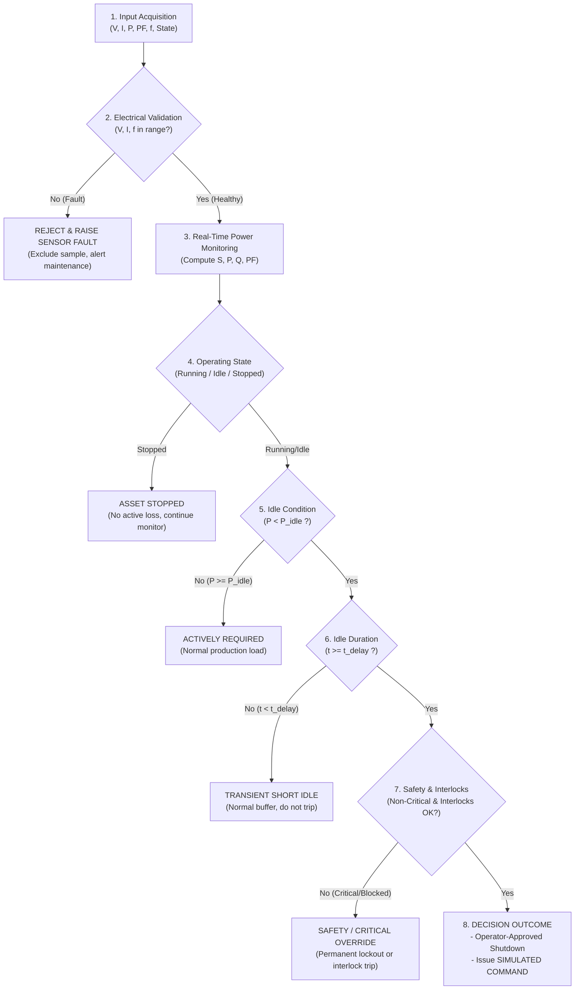

# PLANTPULSE — Intelligent Industrial Energy Optimisation for Sustainable Manufacturing

[-15803d.svg)](https://www.loreal.com)
[](#1-executive-summary--the-core-engineering-thesis)
[](#4-centralized-engineering-calculation-layer)
[](#2-project-status--provenance-honesty)
[-emerald-600.svg)](#10-testing--verification-suite)
[](#7-user-interface-walkthrough--the-10-dedicated-pages)

---

## Table of Contents
1. [Executive Summary & The Core Engineering Thesis](#1-executive-summary--the-core-engineering-thesis)
2. [Project Status & Provenance Honesty](#2-project-status--provenance-honesty)
3. [L'Oréal Sustainability Track Deliverables & Consideration Questions](#3-lor%C3%A9al-sustainability-track-deliverables--consideration-questions)
4. [Centralized Engineering Calculation Layer](#4-centralized-engineering-calculation-layer)
5. [The 8-Step Logical Flow Decision Engine](#5-the-8-step-logical-flow-decision-engine)
6. [System Architecture (Layers L1–L7)](#6-system-architecture-layers-l1l7)
7. [User Interface Walkthrough (The 10 Dedicated Pages)](#7-user-interface-walkthrough--the-10-dedicated-pages)
8. [Proposed Hardware Architecture (Implementation Pending)](#8-proposed-hardware-architecture-implementation-pending)
9. [Pilot Implementation Plan & Roadmap](#9-pilot-implementation-plan--roadmap)
10. [Testing & Verification Suite](#10-testing--verification-suite)
11. [Quickstart & Execution Guide](#11-quickstart--execution-guide)
12. [Project Directory Structure](#12-project-directory-structure)

---

## 1. Executive Summary & The Core Engineering Thesis

In continuous and batch manufacturing facilities, secondary motors, fans, pumps, compressors, and conveyors frequently remain energized across meal breaks, line sanitization, product changeovers, and shift handovers. While drawing significant electrical power from the plant bus, they perform **zero useful mechanical work**.

**PlantPulse** is a non-AI, non-ML, simulation-based engineering decision-support platform engineered around one straightforward physical reality:

$$\text{Idle operation has a distinct electrical signature: low active power } (P < P_{\text{idle}}) \text{ sustained beyond an engineering delay } (t \ge t_{\text{delay}}).$$

Measured against an unmitigated shift baseline, unaddressed idle kilowatt-hours become a quantifiable, actionable decarbonization opportunity.

```
       +--------------------------------------------------------------------------+
       |             TYPICAL INDUSTRIAL FEEDER 24-HOUR POWER PROFILE              |
Power  |                                                                          |
 (kW)  |  +--------------------+                               +---------------+  |
       |  | ACTIVE PRODUCTION  |                               | ACTIVE PROD.  |  |
       |  | (Useful Output)    |   P_idle Threshold            | (Useful Output|  |
       | -+--------------------+ - - - - - - - - - - - - - - - +---------------+ -|
       |                       | t_delay |   AVOIDABLE IDLE    |                  |
       |                       | Buffer  |     ELECTRICITY     |                  |
       |                       +---------+=====================+                  |
       +--------------------------------------------------------------------------+
                                  Time (Hours) ->
```

PlantPulse ingests 3-phase electrical telemetry ($V_{\text{LL}}, I_{\text{line}}, P, Q, PF, f$), identifies qualifying idle states, calculates avoidable energy consumption ($E_{\text{avoid}}$), presents human-interpretable decision traces, and coordinates simulated operator-approved controlled shutdowns of eligible non-critical equipment.

### Core Retrofit Principle
PlantPulse **complements, rather than replaces**, existing motor starters, contactors, variable frequency drives (VFDs), motor protection relays, and programmable logic controllers (PLCs). It acts strictly as an optimization supervisor.

---

## 2. Project Status & Provenance Honesty

To maintain rigorous engineering integrity, the platform enforces strict provenance labeling across every API response, database entity, and UI element:

* **Official Status**: `PROPOSED CONCEPT · DESIGN STAGE · NO RESULTS CLAIMED YET`
* **Data Provenance**: `SIMULATED / DEMONSTRATION DATA`. All baseline figures, idle hours, and cost/emission reductions are derived from mathematical physics models. No field-measured results are claimed.
* **Badging System**: Every visual data point in the UI carries an explicit provenance badge:
  * `[SIMULATED]`: Generated by the deterministic 7-scenario physical engine.
  * `[DERIVED]`: Calculated using classical AC power engineering equations ($S, P, Q, PF, E$).
  * `[ESTIMATED]`: Computed from operational assumptions ($E_{\text{avoid}}$, cost savings, emissions).
  * `[CONFIGURED]`: User-defined engineering thresholds ($P_{\text{idle}}$, $t_{\text{delay}}$, tariffs).
  * `[IMPORTED]`: Ingested via external CSV/JSON field-metering files.
* **Scope Exclusion**: Water consumption and material scrap reduction are outside the scope of this prototype and explicitly marked as `Not in scope of current prototype (energy only)`.

---

## 3. L'Oréal Sustainability Track Deliverables & Consideration Questions

### Track Deliverables Matrix
The application satisfies all four mandatory deliverables specified in Option 03 (*"Less Waste, Smarter Resource Use"*):

| Required Deliverable | Platform Engineering Implementation | Accessible In-App Location |
| :--- | :--- | :--- |
| **(1) Baseline Data Needed** | Captures 3-phase line-to-line RMS voltage ($V_{\text{LL}}$), line RMS current ($I$), active power ($P$), power factor ($PF$), grid frequency ($f$), operating status, and 4-point safety interlock loops. | **Page 1: Dashboard** & **Page 8: Reports** |
| **(2) Proposed Solution** | Deterministic 8-step logical flow engine; rule-based $P_{\text{idle}}$ and $t_{\text{delay}}$ qualification; operator-approved simulated contactor/VFD controlled shutdown. | **Page 4: Optimisation** & **Page 5: Control** |
| **(3) Pilot Plan** | 4-step pilot methodology (Baseline Measurement $\to$ Idle Signature Calibration $\to$ Controlled Comparison $\to$ Verification) + 6-stage roadmap. | **Page 8: Reports (Pilot Plan tab)** |
| **(4) Measures Block** | Real-time active power ($\text{kW}$), cumulative energy ($\text{kWh}$), idle $\text{kWh}$, avoidable $\text{kWh}$, financial savings, and $\text{kg CO}_2\text{e}$ reductions. | **Page 1: Dashboard**, **Page 3: Idle**, **Page 6: Savings** |

---

### The Three Consideration Questions Answered

```
+----------------------------------------------------------------------------------------------------+
| 1. WHERE DOES THE LOSS OCCUR?                                                                      |
| -> Answered on Page 3 (Idle Analysis).                                                             |
| Loss occurs primarily in secondary auxiliary loads: ventilation fans, utility compressors, slurry  |
| agitators, and packaging conveyor drives that remain spinning unloaded during shift breaks, line   |
| washdowns, and downstream jams. Extruder main drives and cooling tower pumps are critical assets   |
| and are permanently protected from automated shutdown.                                            |
+----------------------------------------------------------------------------------------------------+
| 2. CAN PROCESS, EQUIPMENT, PLANNING, OR EMPLOYEE PRACTICES REDUCE IT?                              |
| -> Answered on Page 4 (Optimisation & Recommendations) & Page 8 (Reports).                         |
| - Process: Interlocking auxiliary run-permissives with upstream hopper and discharge sensors.       |
| - Equipment: Upgrading fixed-speed contactors to VFDs with automated sleep/wake standby modes.     |
| - Planning: Staggering auxiliary start sequences to prevent simultaneous inrush demand spikes.     |
| - Practices: Implementing 1-click operator sign-off dashboards during scheduled shift changeovers. |
+----------------------------------------------------------------------------------------------------+
| 3. WHAT TRADE-OFFS SHOULD BE CHECKED?                                                              |
| -> Answered on Page 4 (Trade-off Checklist) & Page 5 (Control & Safety).                           |
| - Motor Inrush & Thermal Stress: Mitigated via configured Max Restarts Per Hour (3 to 6/hr) and   |
|   Minimum Off-Time buffers (120s to 360s).                                                         |
| - Production Restart Latency: Mitigated by limiting shutdown to long idle events (t >= t_delay).   |
| - Plant Safety & Asset Protection: Mitigated via 4 hard-wired interlock checks (E-stop, thermal    |
|   overload, process permissive, manual bypass) and permanent critical asset exclusions.           |
+----------------------------------------------------------------------------------------------------+
```

---

## 4. Centralized Engineering Calculation Layer

All equations are isolated in a single, rigorously tested Python module:  
[`backend/app/engineering/calculations.py`](file:///C:/Users/Ranadheer%20Reddy/OneDrive/Desktop/Folders/Projects/PlantPulse/backend/app/engineering/calculations.py).  
The frontend **never** reimplements mathematical logic; it strictly renders values emitted by this module.

### 4.1 Balanced 3-Phase AC Fundamentals
*Assumes balanced 3-phase industrial power distribution ($V_{\text{LL}} = 415\text{ V}$, $f = 50\text{ Hz}$).*

1. **Apparent Power ($S$)**:
   $$S = \frac{\sqrt{3} \times V_{\text{LL}} \times I_{\text{line}}}{1000} \quad [\text{kVA}] \quad \text{(Provenance: DERIVED)}$$
   *Guards: $V < 0$ or $I < 0 \implies S = 0.0\text{ kVA}$.*

2. **Active Power ($P$)**:
   $$P = \frac{\sqrt{3} \times V_{\text{LL}} \times I_{\text{line}} \times PF}{1000} \quad [\text{kW}] \quad \text{or metered directly} \quad \text{(DERIVED / IMPORTED)}$$

3. **Power Factor ($PF$)**:
   $$PF = \frac{P}{S} \quad [\text{dimensionless}] \quad \text{(DERIVED)}$$
   *Guards: If $S \le 10^{-6}\text{ kVA}$, returns $1.0$ if $P > 0$ else $0.0$; clamps within $[0.0, 1.0]$.*

4. **Reactive Power ($Q$)**:
   $$Q = \sqrt{\max\left(0.0, \, S^2 - P^2\right)} \quad [\text{kvar}] \quad \text{(DERIVED)}$$

### 4.2 Energy Integration via Numerical Trapezoidal Rule
Cumulative energy is evaluated across non-uniform, discrete telemetry timestamps:

$$E = \int_{t_0}^{t_n} P(t) \, dt \approx \sum_{i=1}^{n} \frac{P_{i-1} + P_i}{2} \times \frac{t_i - t_{i-1}}{3600} \quad [\text{kWh}] \quad \text{(DERIVED)}$$

*Guard: Non-monotonic or duplicate timestamps ($\Delta t \le 0$) are rejected to prevent mathematical divergence.*

### 4.3 Idle Condition & Avoidable Energy Quantification
1. **Instantaneous Idle Condition**:
   $$\text{idle}(t) = \left(P(t) < P_{\text{idle}}\right) \land \left(\text{state}(t) \in \{\text{RUNNING}, \text{IDLE}\}\right)$$
   *(Note: Stopped equipment $P \approx 0$ is excluded from idle loss).*

2. **Qualifying Idle Period**:
   $$\Delta t_{\text{idle}} = t_{\text{end}} - t_{\text{start}} \ge t_{\text{delay}}$$
   *Where $t_{\text{delay}}$ (90s–240s) filters out transient pauses (e.g. part indexing).*

3. **Avoidable Idle Energy ($E_{\text{avoid}}$)**:
   $$E_{\text{avoid}} = \begin{cases}
   \int_{t_{\text{start}} + t_{\text{delay}}}^{t_{\text{end}}} P(t) \, dt & \text{if NON-CRITICAL and ELIGIBLE} \\
   0.0 & \text{if CRITICAL or INELIGIBLE}
   \end{cases} \quad [\text{kWh}] \quad \text{(ESTIMATED)}$$

### 4.4 Financial, Emissions, and Before/After Comparability
* **Net Energy Savings**: $E_{\text{save}} = \max(0.0, \, E_{\text{avoid}} - E_{\text{restart\_allowance}}) \quad [\text{kWh}]$
* **Cost Savings**: $\text{Cost} = E_{\text{save}} \times \text{Tariff} \quad [\text{USD or configured currency}]$
* **Emissions Reduction**: $\text{Carbon} = E_{\text{save}} \times \text{Emission Factor} \quad [\text{kg CO}_2\text{e}]$ *(Configured reference: $0.42\text{ kg CO}_2\text{e/kWh}$)*.
* **Fairness Guarantee**: Before/after comparisons are computed **strictly between two runs sharing the exact same random seed ($202$), operational schedule, and runtime duration**.

---

## 5. The 8-Step Logical Flow Decision Engine

Implemented as a deterministic, explainable finite state machine in [`backend/app/services/logical_flow.py`](file:///C:/Users/Ranadheer%20Reddy/OneDrive/Desktop/Folders/Projects/PlantPulse/backend/app/services/logical_flow.py). Every evaluation persists an audit trace:



---

## 6. System Architecture (Layers L1–L7)

PlantPulse strictly partitions industrial functionality into 7 architectural layers:

```
+----------------------------------------------------------------------------------------------------+
| L7: GOVERNANCE & ACCESS CONTROL                                                                    |
| Role-Based Access (Operator, Energy Manager, Maintenance, Admin) · Session Store · Full Audit Log |
+----------------------------------------------------------------------------------------------------+
| L6: USER INTERFACE & REPORTING                                                                     |
| Pure White Primary Background UI (10 Dedicated Pages) · PDF/Print Report Engine · Live Trend Cards |
+----------------------------------------------------------------------------------------------------+
| L5: CONTROL & SAFETY INTEGRITY                                                                     |
| Simulated Contactor/VFD Adapter · Operator Approval Queue · Thermal Overload & E-Stop Interlocks   |
+----------------------------------------------------------------------------------------------------+
| L4: OPTIMISATION & DECISION STATE MACHINE                                                          |
| Deterministic 8-Step Logic Engine · Trace Generator · Trade-Off Mitigation Scoring Rules           |
+----------------------------------------------------------------------------------------------------+
| L3: ENERGY ANALYSIS & CALCULATIONS                                                                 |
| Centralized /engineering/calculations.py · S, P, Q, PF · Trapezoidal kWh · E_avoid Integration     |
+----------------------------------------------------------------------------------------------------+
| L2: DATA ACQUISITION & INGESTION                                                                   |
| Deterministic 7-Scenario Telemetry Engine · CSV/JSON Data Importer · 3-Sample Alert Debouncer       |
+----------------------------------------------------------------------------------------------------+
| L1: PHYSICAL / DEMONSTRATION ELECTRICAL FEEDER                                                     |
| 3-Phase 415 V LL, 50 Hz Feeder · 8 Industrial Assets (2 Critical Permanently Locked, 6 Eligible)   |
+----------------------------------------------------------------------------------------------------+
```

### Demonstration Equipment Inventory
| ID | Asset Name | Type | Rated kW | Rated A | $P_{\text{idle}}$ Threshold | $t_{\text{delay}}$ | Criticality | Shutdown Eligible? |
| :--- | :--- | :--- | :---: | :---: | :---: | :---: | :---: | :---: |
| `eq_main_process_motor` | Main Process Extruder Motor | Motor | 75.0 kW | 130 A | 15.0 kW | 180 s | **CRITICAL** | **PERMANENT NO** |
| `eq_cooling_water_pump` | Cooling Tower Circulation Pump | Pump | 45.0 kW | 78 A | 10.0 kW | 180 s | **CRITICAL** | **PERMANENT NO** |
| `eq_conveyor_motor` | Assembly Infeed Conveyor | Motor | 22.0 kW | 39 A | 5.0 kW | 120 s | NON_CRITICAL | Yes |
| `eq_exhaust_fan` | Fume Extraction Exhaust Fan | Fan | 30.0 kW | 52 A | 7.0 kW | 120 s | NON_CRITICAL | Yes |
| `eq_air_compressor` | Utility Pneumatic Compressor | Aux | 55.0 kW | 95 A | 14.0 kW | 240 s | NON_CRITICAL | Yes |
| `eq_mixer_drive` | Slurry Vessel Mixer Drive | Motor | 37.0 kW | 64 A | 8.0 kW | 180 s | NON_CRITICAL | Yes |
| `eq_auxiliary_pump` | Washdown Auxiliary Pump | Pump | 15.0 kW | 26 A | 3.5 kW | 90 s | NON_CRITICAL | Yes |
| `eq_packing_feeder` | End-of-Line Packaging Feeder | Aux | 18.5 kW | 32 A | 4.0 kW | 120 s | NON_CRITICAL | Yes |

---

## 7. User Interface Walkthrough (The 10 Dedicated Pages)

The frontend features a clean, high-contrast **pure white primary background (`#ffffff`)** built with React 18, TypeScript, and Tailwind CSS.

### Access & Sign-In Page
A role-governed entrance guarding the platform. Displays 4 pre-configured clickable demo account cards:
* **Operator** (`operator` / `operator123`): Authorized to approve or reject simulated contactor shutdown commands.
* **Energy Manager** (`energymgr` / `energy123`): Access to baseline reports, financial savings, and emissions audits.
* **Maintenance** (`maintenance` / `maint123`): Access to sensor validation, E-stop loops, and overload resets.
* **Admin** (`admin` / `admin123`): Global site thresholds, electrical bounds, and tariff rates.

### The 10 Primary Navigation Pages
1. **1. Dashboard**: Executive headline metrics (Site Total Active kW, Total kVA, Power Factor, Total kWh), real-time idle equipment counters, estimated financial savings, and a 24-point load sparkline.
2. **2. Equipment Monitoring**: Complete 8-asset telemetry matrix with live active power, 3-phase line current, voltage, power factor, operating state (RUNNING/IDLE/STOPPED), and critical asset protection locks.
3. **3. Idle Analysis**: Answers *"Where does the loss occur?"* Features an avoidable idle energy Pareto ranking, idle share percentages, and an expandable qualifying idle periods log.
4. **4. Optimisation & Recommendations**: Visualizes the 8-step decision state machine with step-by-step traces for every sample, plus the **Track Consideration Question 3 Trade-Off Mitigation Checklist**.
5. **5. Control & Safety (SIM)**: Operator sign-off queue for controlled shutdowns, a live simulated contactor log (`SIMULATED COMMAND`), and a 4-point safety interlock matrix (E-Stop, Overload Relay 95/96, Process Permissive, Maintenance Bypass).
6. **6. Savings & Baseline**: Fair before-and-after comparison between unmanaged and managed operational runs under identical seed conditions ($202$), proving genuine kWh reductions.
7. **7. Event History & Alerts**: Non-binding advisory alert log with 3-sample debouncing and 5-minute hysteresis to prevent notification floods. Filterable by severity (WARNING, ATTENTION, MONITOR) with Operator/Maintenance acknowledge actions.
8. **8. Reports & Pilot Plan**: Executive live assessment report generator with print/PDF styling, the 4-step pilot methodology, and the 6-stage engineering roadmap.
9. **9. Data Import**: Drag-and-drop CSV and JSON data ingestion pipeline for external PQ loggers (Fluke, Chauvin Arnoux) with schema validation and sample template download.
10. **10. Settings & Governance**: Configurable site parameters (nominal voltage, frequency ranges, power factor limit, tariffs, emission factor, alert debouncers) and the **Proposed Hardware Architecture** blueprint.

---

## 8. Proposed Hardware Architecture (Implementation Pending)

```
       [ 3-Phase 415 V (Line-to-Line) 50 Hz Feeder Bus ]
                               |
            +------------------+------------------+
            |                                     |
            v                                     v
     [ VT / PT Sensing ]                  [ CT Sensing ]
   (415 V LL -> 110 V / 3.3 V)          (Split-core 100:5A)
            |                                     |
            +------------------+------------------+
                               |
                               v
               +-------------------------------+
               |     DEDICATED METERING IC     |
               | (ADE9000 / ATM90E36A 24-bit)  |
               +-------------------------------+
                               | Isolated SPI / UART
                               v
               +-------------------------------+
               |    EDGE EMBEDDED CONTROLLER   |
               |     (ARM Cortex-M4 / Linux)   |
               +-------------------------------+
                     |                   |
 (Simulated Telemetry Pipeline)          | (Simulated Contactor/VFD Interface)
                     v                   v
           +-------------------+  +--------------------------------+
           | PLANTPULSE CLOUD/ |  | SAFETY INTERLOCK INTERFACE     |
           | LOCAL EDGE SERVER |  | - Emergency Stop Loop          |
           | - 8-Step Engine   |  | - Overload Relay Contacts 95/96|
           | - Operator Signoff|  | - Process Permissive Relay     |
           +-------------------+  | - Manual Maintenance Bypass    |
                                  +--------------------------------+
                                                 |
                                                 v
                                  [ Contactor Auxiliary Trip / VFD Standby ]
```

* **Non-Intrusive CTs**: Split-core current transformers clip around feeder leads without interrupting production busbars.
* **Safety Isolation**: Potential transformers provide galvanic isolation between 415 V line voltages and 3.3 V measurement electronics.
* **Fail-Safe Interlock**: The control relay contacts are wired in series with the contactor coil circuit downstream of existing safety relays. If the controller loses power, the contactor remains in its fail-safe state.

---

## 9. Pilot Implementation Plan & Roadmap

### The 4-Step Pilot Methodology
1. **Step 1: Baseline Energy Measurement (2–4 Weeks)**: Connect split-core CTs in listen-only mode. Record baseline power profiles without enabling any contactor shutdowns.
2. **Step 2: Idle Signature Calibration**: Refine individual $P_{\text{idle}}$ thresholds and $t_{\text{delay}}$ buffers per asset to eliminate false trips during legitimate short line pauses.
3. **Step 3: Controlled Before-and-After Comparison**: Enable operator-approved shutdowns across alternating production shifts while maintaining identical batch recipes and throughput.
4. **Step 4: Verification Under Comparable Conditions**: Normalize energy savings against production volume and ambient temperature; inspect motor winding thermal rise to verify zero degradation.

### 6-Stage Roadmap
* **Stage 1: System Design** — *IN PROGRESS* (Algorithmic state machine, calculation layer, and UI platform delivered).
* **Stage 2: Component Selection** — *PLANNED* (Sizing split-core CTs, ADE9000 ICs, DIN-rail relays).
* **Stage 3: Hardware Prototype Development** — *PLANNED* (Building certified edge retrofit enclosure).
* **Stage 4: Functional Testing in Test Cell** — *PLANNED* (Bench testing on a 415 V motor dyno).
* **Stage 5: Industrial Pilot Validation** — *PLANNED* (Single manufacturing line pilot).
* **Stage 6: Multi-Site Scaling** — *PLANNED* (Plant-wide packaging line rollout).

---

## 10. Testing & Verification Suite

The platform includes a comprehensive, automated test suite covering direct calculations, numerical edge cases, and multi-step state machine transitions:

```bash
python -m pytest tests/ -v
```

### Test Suite Execution Results (All 29 Passed in 0.77s)
```
============================= test session starts =============================
platform win32 -- Python 3.14.7, pytest-9.1.1 -- C:\PYTHON\python.exe
rootdir: backend
collected 29 items

tests/test_api_direct.py::test_analytics_dashboard PASSED                [  3%]
tests/test_api_direct.py::test_equipment_listing_and_critical_exclusion PASSED [  6%]
tests/test_api_direct.py::test_idle_ranking PASSED                       [ 10%]
tests/test_api_direct.py::test_decisions_and_tradeoffs PASSED            [ 13%]
tests/test_api_direct.py::test_control_approval_and_critical_rejection PASSED [ 17%]
tests/test_api_direct.py::test_control_simulated_restart_on_eligible PASSED [ 20%]
tests/test_api_direct.py::test_interlocks_panel PASSED                   [ 24%]
tests/test_api_direct.py::test_savings_baseline_comparison PASSED        [ 27%]
tests/test_api_direct.py::test_live_reports_assessment PASSED            [ 31%]
tests/test_api_direct.py::test_scenarios_listing PASSED                  [ 34%]
tests/test_api_direct.py::test_auth_login PASSED                         [ 37%]
tests/test_calculations.py::test_apparent_power_hand_computed PASSED     [ 41%]
tests/test_calculations.py::test_apparent_power_edge_cases PASSED        [ 44%]
tests/test_calculations.py::test_active_power PASSED                     [ 48%]
tests/test_calculations.py::test_power_factor_and_reactive_power PASSED  [ 51%]
tests/test_calculations.py::test_energy_trapezoidal_integration PASSED   [ 55%]
tests/test_calculations.py::test_energy_trapezoidal_non_monotonic_guard PASSED [ 58%]
tests/test_calculations.py::test_idle_condition_and_state PASSED         [ 62%]
tests/test_calculations.py::test_idle_periods_duration_and_avoidable PASSED [ 65%]
tests/test_calculations.py::test_estimated_savings_and_before_after PASSED [ 68%]
tests/test_logical_flow.py::test_step_2_rejection_voltage_fault PASSED   [ 72%]
tests/test_logical_flow.py::test_step_4_stopped_state PASSED             [ 75%]
tests/test_logical_flow.py::test_step_5_normal_production_load PASSED    [ 79%]
tests/test_logical_flow.py::test_step_6_transient_short_idle PASSED      [ 82%]
tests/test_logical_flow.py::test_step_7_critical_load_permanent_exclusion PASSED [ 86%]
tests/test_logical_flow.py::test_step_7_interlock_blocked PASSED         [ 89%]
tests/test_logical_flow.py::test_step_7_restart_protection_limit PASSED  [ 93%]
tests/test_logical_flow.py::test_step_8_sustained_idle_awaiting_approval PASSED [ 96%]
tests/test_logical_flow.py::test_step_8_approved_controlled_shutdown PASSED [100%]

============================= 29 passed in 0.77s ==============================
```

---

## 11. Quickstart & Execution Guide

### 1-Click Launch & Stop (Windows)
* **Start PlantPulse**: Double-click [`start_plantpulse.bat`](file:///C:/Users/Ranadheer%20Reddy/OneDrive/Desktop/Folders/Projects/PlantPulse/start_plantpulse.bat).
  * Automatically verifies Python and the SQLite database.
  * Launches the Uvicorn production server.
  * Synchronously polls the `/health` endpoint and automatically opens your default browser at `http://127.0.0.1:8000`.
* **Stop PlantPulse**: Double-click [`stop_plantpulse.bat`](file:///C:/Users/Ranadheer%20Reddy/OneDrive/Desktop/Folders/Projects/PlantPulse/stop_plantpulse.bat).
  * Cleans up port 8000 socket listeners and cleanly shuts down background processes.
* **Run Test Suite**: Double-click [`run_tests.bat`](file:///C:/Users/Ranadheer%20Reddy/OneDrive/Desktop/Folders/Projects/PlantPulse/run_tests.bat).

### Manual Setup & Execution

#### Prerequisites
* **Python**: 3.10+ (tested on Python 3.14)
* **Node.js**: 18+ and `npm`

#### 1. Backend Initialization
```bash
cd backend

# Initialize database schema and generate deterministic baseline telemetry
python -m app.services.seed

# Run the backend production server
python run_server.py
```
* Interactive API Documentation (Swagger / OpenAPI): `http://127.0.0.1:8000/docs`
* Application Health Check: `http://127.0.0.1:8000/health`

#### 2. Frontend Build (Optional for Development)
```bash
cd frontend

# Install dependencies
npm install

# Build static production assets
npm run build

# Or launch live development hot-reload server
npm run dev
```

---

## 12. Project Directory Structure

```
PlantPulse/
|-- backend/
|   |-- app/
|   |   |-- api/
|   |   |   |-- routers/             # 13 REST API endpoints under /api/v1
|   |   |   |   |-- analytics.py      # Dashboard overview and sparkline trends
|   |   |   |   |-- auth.py           # Role governance & session authentication
|   |   |   |   |-- config.py         # Site parameters and threshold settings
|   |   |   |   |-- control.py        # Operator sign-offs and simulated contactors
|   |   |   |   |-- decisions.py      # 8-step decision traces and trade-offs
|   |   |   |   |-- equipment.py      # Equipment inventory and critical flags
|   |   |   |   |-- events.py         # Debounced alert engine and acknowledgements
|   |   |   |   |-- idle.py           # Avoidable idle ranking and period history
|   |   |   |   |-- import_data.py    # CSV/JSON ingestion pipeline
|   |   |   |   |-- reports.py        # Dynamic assessment report generator
|   |   |   |   |-- savings.py        # Fair before/after baseline calculations
|   |   |   |   |-- scenarios.py      # Physical scenario selector
|   |   |   |   `-- telemetry.py      # Live and historical sample queries
|   |   |-- core/
|   |   |   |-- config.py             # Pydantic v2 application settings
|   |   |   |-- database.py           # SQLAlchemy 2.0 SQLite engine
|   |   |   `-- provenance.py         # Provenance badges, roles, and Value model
|   |   |-- engineering/
|   |   |   `-- calculations.py       # PURE CENTRALIZED FORMULAS (S, P, Q, PF, E)
|   |   |-- models/
|   |   |   `-- entities.py           # 17 Relational ORM models
|   |   |-- schemas/
|   |   |   `-- domain.py             # Pydantic domain models and validation
|   |   |-- services/
|   |   |   |-- alert_engine.py       # 3-sample debounce & 5-minute hysteresis
|   |   |   |-- import_engine.py      # External CSV/JSON validator & mapper
|   |   |   |-- logical_flow.py       # Deterministic 8-step decision state machine
|   |   |   |-- report_engine.py      # Dynamic assessment report builder
|   |   |   |-- scenario_engine.py    # 7 Physical load scenarios generator
|   |   |   `-- seed.py               # Database seeder (8 assets, 4 users)
|   |   `-- main.py                   # FastAPI ASGI entrypoint & SPA static mount
|   |-- tests/
|   |   |-- test_api_direct.py        # 11 Direct API router & integration tests
|   |   |-- test_calculations.py      # 9 Classical power calculation tests
|   |   `-- test_logical_flow.py      # 9 Step-by-step state machine transition tests
|   |-- plantpulse.db                 # Persistent SQLite database
|   `-- run_server.py                 # Server launcher with synchronized browser opener
|-- docs/
|   |-- ARCHITECTURE.md               # L1–L7 architectural layer specifications
|   |-- DEMO_SCRIPT.md                # 10-minute presentation & evaluation walkthrough
|   |-- HARDWARE_ARCHITECTURE.md      # Retrofit VT/CT, metering IC, and relay design
|   |-- METHODOLOGY.md                # Classical AC mathematical proofs and formulas
|   `-- PILOT_PLAN.md                 # 4-step pilot methodology & 6-stage roadmap
|-- frontend/
|   |-- src/
|   |   |-- api/client.ts             # Centralized typed API client
|   |   |-- components/common/        # Header banner, sidebar, provenance badge
|   |   |-- pages/                    # 10 Dedicated page modules + Sign-In page
|   |   |   |-- LoginPage.tsx         # Accessible role-based authentication screen
|   |   |   |-- DashboardPage.tsx     # 1. Executive operational headline metrics
|   |   |   |-- EquipmentMonitoringPage.tsx # 2. 8-Asset inventory & electrical profiles
|   |   |   |-- IdleAnalysisPage.tsx  # 3. Where loss occurs (avoidable kWh ranking)
|   |   |   |-- OptimisationPage.tsx  # 4. 8-Step trace visualizer & trade-offs
|   |   |   |-- ControlSafetyPage.tsx # 5. Operator approval queue & simulated contactor
|   |   |   |-- SavingsBaselinePage.tsx # 6. Controlled before/after savings audit
|   |   |   |-- EventsAlertsPage.tsx  # 7. Debounced advisory alert management
|   |   |   |-- ReportsPage.tsx       # 8. Dynamic assessment & 4-step pilot plan
|   |   |   |-- DataImportPage.tsx    # 9. CSV/JSON external PQ upload & validation
|   |   |   `-- SettingsPage.tsx      # 10. Site thresholds & proposed hardware view
|   |   |-- types/index.ts            # Shared domain TypeScript types
|   |   |-- App.tsx                   # Root state manager & session coordinator
|   |   `-- index.css                 # Pure white industrial design styling
|   `-- dist/                         # Compiled, bundled production web assets
|-- run_tests.bat                     # 1-Click pytest runner
|-- start_plantpulse.bat              # 1-Click application launcher
|-- stop_plantpulse.bat               # 1-Click application stopper
`-- README.md                         # Master documentation & challenge deliverable
```

---

**PlantPulse** — Engineered for the *L'Oréal Sustainability Challenge (Option 03: "Less Waste, Smarter Resource Use")*.  
*Notice: Proposed Concept · Design Stage · All demonstration figures derived from simulated deterministic models.*
