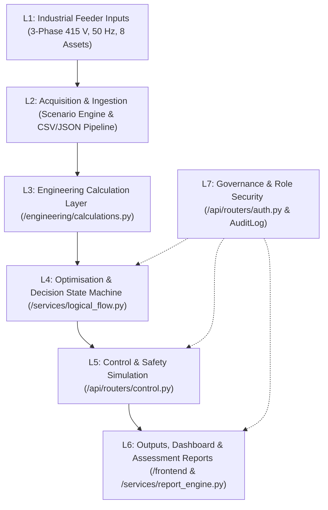

# PLANTPULSE Architecture Documentation

## L1–L7 Architectural Mapping

PlantPulse is structured strictly around 7 architectural layers (L1–L7). Each layer has a direct correspondence to code packages within the platform:

---

### Layer-by-Layer Code Mapping

| Layer | System Function | Corresponding Code Module |
| :--- | :--- | :--- |
| **L1: Inputs** | Demonstration industrial site: 3-Phase 415 V line-to-line RMS, 50 Hz supply powering 8 simulated equipment items (2 critical, 6 non-critical). | `backend/app/models/entities.py` (`SiteConfig`, `Equipment`) |
| **L2: Acquisition** | Deterministic physical telemetry generation across 7 scenarios ($P = \sqrt{3}VI\cdot PF$), plus external CSV/JSON import pipeline. | `backend/app/services/scenario_engine.py` & `backend/app/services/import_engine.py` |
| **L3: Engineering Analysis** | Single centralized calculation layer computing $S, P, Q, PF, E$, continuous idle durations, avoidable energy, and emissions. | `backend/app/engineering/calculations.py` |
| **L4: Optimisation Engine** | Deterministic 8-step decision state machine with per-sample explainable evaluation traces and trade-off checklist. | `backend/app/services/logical_flow.py` & `backend/app/api/routers/decisions.py` |
| **L5: Control & Safety** | Software-simulated contactor/VFD command adapter, operator approval queues, interlock checks, and safe-restart limiter. | `backend/app/api/routers/control.py` |
| **L6: Outputs & Reporting** | Pure white primary background frontend (10 pages) and dynamic live report generation engine. | `frontend/src/pages/` & `backend/app/services/report_engine.py` |
| **L7: Governance** | Role-based permissions (Operator, Energy Manager, Maintenance, Admin), provenance tracking, and audit logging. | `backend/app/core/provenance.py`, `backend/app/models/entities.py` (`AuditLog`) |
